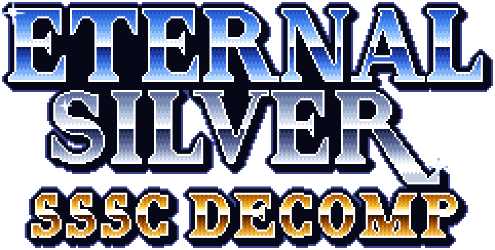
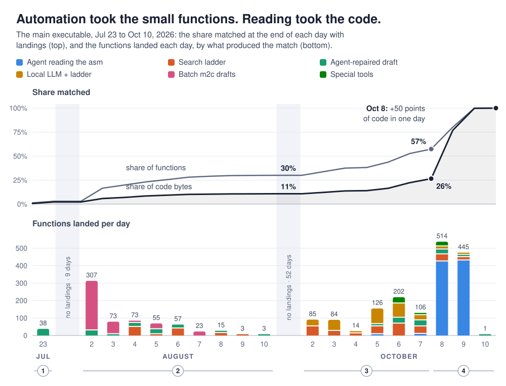

<p align="center">
  
</p>

# Eternal Silver SSSC decomp

A matching decompilation of *Lunar: Silver Star Story Complete* (PlayStation,
North America, 1999): C source that, compiled with the compilers the game was
built with, produces the same bytes as the original program.

"Matching" is a checked claim, not a description. `make` builds each program
and compares it with the original byte for byte; it ends with a line such as

```
OK: 0xa8000 bytes, sha1 900ce6a9dfa9563ef7e0a129602945d1303436d8
```

or it fails.

## The three programs

Each program is one executable image and has a tree of its own, named by its
serial as Sony names it:

- **Main executable**, [`decomp/SLUS_006.28/`](decomp/SLUS_006.28/): the game
  itself. Both game discs boot it.
- **Overlay**, [`decomp/SLUS_006.28-MENU/`](decomp/SLUS_006.28-MENU/):
  `MENU.BIN`, the movie player the game loads over itself before each movie.
- **Bonus disc**, [`decomp/SLUS_009.21/`](decomp/SLUS_009.21/): "The Making of
  Lunar", which also holds the hidden Lords of Lunar minigame.

<!-- progress: begin. `make status` writes what is between these two lines. -->
| Program | All functions | Functions to decompile | All code bytes | Code bytes to decompile |
|---|:---:|:---:|:---:|:---:|
| Main executable |  |  |  |  |
| Overlay |  |  |  |  |
| Bonus disc |  |  |  |  |
| All three |  |  |  |  |

Each badge is a share in C, counted by functions or by code bytes. *All*
counts all of a program's code. *To decompile* leaves out what is not
decompilation work: the routines that were assembly in the original and the
copies of Sony's library code still read as bytes. Bytes show how much is
left by size, since one function can be a thousand times the size of
another. Each program includes the parts of Sony's PSY-Q libraries it links,
and they count like the rest. Measured by `make status` on 2026-10-20;
[docs/progress.md](docs/progress.md) has every count, what is left in each
program, and the history.
<!-- progress: end -->

## Building

Three steps, the first two once. [BUILD.md](BUILD.md) explains each and says
what it needs.

```sh
recipe/toolchain.sh                         # the compilers, the assembler, Sony's SDK headers
python3 recipe/extract.py <your disc images>  # the program images, from discs you own
make programs                               # build all three and compare
make status                                 # optional: build them and update the progress figures
```

## What is not in this repository

None of the game's files are in this repository: no disc image, no file from
the disc, no program image. A build needs three things that are not here, and
each comes from somewhere else:

- **The program images.** `decomp/<serial>/expected/code.bin` is what a tree
  is compared with. `recipe/extract.py` cuts it out of your own disc and
  keeps it only if its sha1 is the one the tree declares.
- **The code that is still assembly, and the data.** The files under
  `decomp/<serial>/asm/` hold labels and byte ranges, never instructions or
  data: a line reads `.incbin "expected/code.bin", 0x7DC, 0xF4`, and the
  assembler takes those bytes from your image. A function leaves that folder
  when it is written in C.
- **Sony's SDK headers.** The C includes Sony's PSY-Q headers by name.
  `recipe/toolchain.sh` fetches them from a public tree, or you point the
  build at a copy of your own.

The routines Sony wrote in assembly can come from a second place. They are
in the game exactly as they are in Sony's SDK libraries, so `make CODE=sdk`
reads all 65 of the main executable's from Sony's own files, fetched on
request and never kept here, and ends with the same OK line. The stubs for that are
under `decomp/SLUS_006.28/from-sdk/`.

What is here is the decompiled C, the layout facts a build needs (symbol
addresses, the linker scripts, per-file compiler flags), the build recipe, and
the specification written while reading the program. The C is a
decompilation: it derives from the game's program, and [NOTICE.md](NOTICE.md)
says what that means for the licence.

## Layout

| Path | What |
|---|---|
| `decomp/<serial>/src/` | The matching C, one file per original object where that is known |
| `decomp/<serial>/asm/` | What is not C yet, as labels and byte ranges of your image |
| `decomp/SLUS_006.28/from-sdk/` | The routines Sony's SDK also holds, as byte ranges of its libraries (`make CODE=sdk`) |
| `decomp/<serial>/include/` | This project's headers and the assembler macros |
| `decomp/<serial>/config/` | The linker script, the register of names (`symbol_addrs.txt`: each named symbol's address, where its name came from and what backs it), per-file and per-function compiler choices, and the records of which functions were never C |
| `decomp/<serial>/splat.yaml` | The original split's record: load address, `$gp`, segment names, the image's sha1 |
| `recipe/` | The build recipe: the compile pipeline, the image extractor, the toolchain setup |
| `docs/` | The specification: formats, subsystems, the SDK library code ([docs/README.md](docs/README.md)) |
| `Makefile` | Build and compare |

## Names

The C is matching, and only partly readable. In the main program 2,154 of
the 2,321 functions have names, and so do 865 globals (`g_BtlActingSlot`);
the rest are still named for their address (`func_80016608`,
`D_800B8EEC`). The bonus disc has names for 321 of its 404 functions and
the menu overlay for 32 of its 36. Seven parameters of the game's own C
are still `argN`, each because nothing in the program says what it holds,
and of the 1,022 struct fields in the headers 924 have names, 29 are `unk_`
and 69 `pad_`.

A function's address is its identity and its name is a claim about it, so a
name is given only with a record of where it came from, and a function that
has been given one keeps its address on the line above its definition
(`/* func_8008B7F8 */`).
`decomp/<serial>/config/symbol_addrs.txt` is that register, and
[docs/naming.md](docs/naming.md) has the rule, the evidence each kind of
name needs, and what is still open.

Of the main executable's 2,320 function symbols and one routine the build
labels as data (`__main`):

| | Functions |
|---|---:|
| Sony's name, proven against Sony's own libraries in the release the program links (4.5) | 477 |
| A later release's name for Sony code that release leaves unnamed | 2 |
| An earlier release's name for the same bytes, where the linked release gives none | 11 |
| Sony's own text: the function prints its name, or a message of its library member names it | 3 |
| The developers' own name, printed by the function's own assertion or debug line | 9 |
| The name a published source file gives it (Mark Adler's `inflate.c`, Haruhiko Okumura's spline routines), read side by side | 7 |
| A name given by reading the C, with what was read on record | 1,645 |
| Named for their address | 167 |

The first split left 324 more names of its own, which nobody had read and
about a hundred of which were known to be wrong. They were taken away on
2026-10-13; the register keeps what each was called.

The bonus disc, which links the same release, has 286 of its 404 functions
under Sony's names by the same kinds of proof and its own 35 named by
reading. The overlay has 15 of Sony's names (its libpress is release 4.1's)
and 17 given by reading. Every function both programs named for their
address is a private part of one of Sony's library members.

## Outstanding

What is left for the main program and its movie-player overlay, as of
2026-10-19. The bonus disc is out of scope for now. `docs/naming.md`
("Open") has the detail behind each naming row.

| Task | Program | Size | What it needs |
|---|---|---|---|
| `movie_slice_load` (`0x801967DC`), the movie player's slice callback: the last routine of the game's own code still read as assembly | overlay | 1 function | A C text that matches all 61 instructions exists, but only with the slice's fields read through their addresses (`*(&dec.imgbuf)`) and two locals pointing into the decode state, set in that order. No plain spelling has matched (the best scored 50 of 61); the Japanese release's overlay, built by another compiler, has the same addressing. To decide: land that spelling with a note saying why, search again for a plain one, or keep the assembly. |
| The dispatch tables the first split named (`scene_state_table`, `battle_state_table`, `menu_page_table` ...) | main | 36 data labels | Their names are the first split's, read by no one (`src:inherited`). Read each table and give it a name with a record, or its address back, as was done for the first split's function names on 2026-10-13. |
| Build warnings | main | 627 lines a clean build | 580 are in the game's C, 47 in Sony's library files: pointers and integers mixed (25 at calls into libcd, whose prototypes take `u_char` pointers), and implicit declarations whose types do not match. Each fix proven by the build. |
| Sony's parameter names | main | 59 `argN` mentions in 12 of Sony's files | Sony's own names from its prototypes, where they name the parameter, as for Sony's other functions. |
| Struct leftovers | main | a few types | Types for the 0xC00-byte block of records (`CardSave.records`, `g_GameSaveBlock`) and the load buffer at `0x801CFB00`; 29 `unk_` fields; a few offset forms the counter does not find (the sprite sheet directory row, `BtlRecordInit`). |
| `_stacksize` | main | 1 global | The start-up object refers to the word at `0x800B8714` by that name; it is still `D_800B8714`. |
| `__main` | main | 1 routine | Still data to the tree: making it a routine moves the start of the program's code by eight bytes in the linker script. |
| Okumura's routines | main | 5 rows | Assumed to be from the book's 1991 edition, the one the developers could have had; checked against and named after its 2018 edition, whose C files are public. Compare them if a copy of the 1991 edition turns up: `MTH_mysqrt`'s name in particular is the 2018 file's. |

Settled by the owner's rulings, and so not work unless new evidence turns
up: the 61 game functions left unnamed, the 106 Sony statics in the main
program and 4 in the overlay that keep their addresses, the 79 script
command operand bytes left raw, the 175 globals the C still uses by
address (each has a row saying why), and the seven `argN` parameters.

Elsewhere: checking the register and running the SDK proof again are the
tools repository's work; Eternal Silver's citations of these names are
brought up to date from that repository's side.

## Where this came from

The work was done between March and October 2026 in a private repository
that also held the tools used to write the C, the applications built on it
and the asset research. This repository starts from that one's state on
2026-10-11 and takes only what is listed above; it has no history before
that. [HISTORY.md](HISTORY.md) is the timeline reconstructed from the old
one.

<picture>
  <source media="(prefers-color-scheme: dark)" srcset="docs/img/progress-timeline-dark.svg">
  
</picture>

The chart dates each of the main executable's 2,253 functions to decompile
by the commit in the old repository that retired its assembly file; 29 were
C before the first. The work went in four phases:

1. **Jul 23: first matches.** The compiler is pinned down as GCC 2.8.1 at
   `-O2 -G8`, and the first 67 functions match, one at a time.
2. **Aug 2 to 10: drafts in bulk.** Splitting the code again uncovers 515
   functions glued inside others. m2c drafts them, rules repair its drafts,
   and 401 land in batches; a ladder of searches ending in decomp-permuter
   mutates each near-miss until its bytes match. That makes 30% of the
   functions but only 11% of the bytes: the small functions went first.
3. **Oct 2 to 7: a local LLM and a LAN fleet.** A 27-billion-parameter model
   on one desktop GPU drafts what m2c could not, and the searches spread to a
   laptop. 57% of the functions, but still 26% of the bytes.
4. **Oct 8 to 10: one agent per function.** Searching stalls on functions
   longer than about 100 instructions, so Claude Code agents read the
   assembly and write the C, one function each. 959 functions and 73% of the
   code land in two days, 854 of them written this way.

The tools that find a function's C (the conversion loop, the search for a
matching form, the emulator harness) are not here; they will be released
later as station-tools, a custom decomp toolkit. Some comments in the C and
the configuration were written beside them and still name them.

Eternal Silver, a reimplementation of the game's engine by the same author,
is transcribed from this C and this specification.

Much of the C, the specification and the names was written with Claude, an
AI model made by Anthropic, working under the author's direction. The
functions' names were given in waves of Claude sessions that each read a
group of functions and proposed names with what they read; one session
checked every proposal against the program image and the tree and applied
it, and the build proved that the bytes did not change.
[docs/naming.md](docs/naming.md) says how.

## Licence

The author's own work here is MIT-licensed ([LICENSE](LICENSE)). That is not
all of what is here, and [NOTICE.md](NOTICE.md) says what the licence covers,
what it cannot, and whose work this stands on. Parts of Sony's library code
here match other people's decompilations of the same libraries, all
MIT-licensed: each file that has such parts opens with an
`SPDX-License-Identifier: MIT` line naming the files it matches, and their
licences' notices are in [LICENSES/](LICENSES/).

## Attributions

- *Lunar: Silver Star Story Complete* is © 1992–1998 GAME ARTS; © 1996–1998
  Kadokawa Shoten / ESP / JAM; English translation © 1999 Working Designs.
  This repository holds none of its files.
- Sony's PSY-Q libraries and headers are © Sony Computer Entertainment Inc. /
  SN Systems Ltd. They are not in this repository; the build fetches what it
  needs ([NOTICE.md](NOTICE.md)).
- [sotn-decomp](https://github.com/Xeeynamo/sotn-decomp) (Xeeynamo and
  contributors), [psyz](https://github.com/Xeeynamo/psyz) (Xeeynamo, psyqz
  members and sotn-decomp contributors) and
  [psy-q-decomp](https://github.com/sozud/psy-q-decomp) (Sozud and
  contributors): decompilations of the same Sony libraries, which much of
  this repository's library C follows. MIT; notices in [LICENSES/](LICENSES/).
- [splat](https://github.com/ethteck/splat) (ethteck; MIT) and
  [spimdisasm](https://github.com/Decompollaborate/spimdisasm)
  (Decompollaborate): the first split of each program, and the assembler
  macro files under `decomp/<serial>/include/`.
- [decompals/old-gcc](https://github.com/decompals/old-gcc), GCC (GPL), GNU
  binutils (GPL) and [maspsx](https://github.com/mkst/maspsx) (mkst; MIT):
  the toolchain the build fetches or builds.
- [psx_psyq_signatures](https://github.com/lab313ru/psx_psyq_signatures)
  (lab313ru): the signatures that identified the libraries' releases.
- [m2c](https://github.com/matt-kempster/m2c) (Matt Kempster),
  [decomp-permuter](https://github.com/simonlindholm/decomp-permuter) and
  [asm-differ](https://github.com/simonlindholm/asm-differ) (Simon Lindholm),
  [PCSX-Redux](https://github.com/grumpycoders/pcsx-redux) (grumpycoders) and
  [Ghidra](https://ghidra-sre.org/) (NSA): used to write the C.
- Mark Adler's `inflate.c` (gzip 1.2.4) and Haruhiko Okumura's routines from
  his dictionary of algorithms in C: published code the game's developers
  compiled in, read here only to name the game's copies.
- Claude, an AI model made by Anthropic: much of the C, the specification
  and the names were written with it, under the author's direction ("Where
  this came from").

[NOTICE.md](NOTICE.md) has the detail of each.
